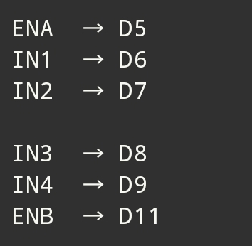

# Circuit Connection & Pin Mapping

## Motor Driver (L298N) to Arduino Connections

| L298N Motor Driver Pin | Arduino Pin | Description | Function |
| :--- | :--- | :--- | :--- |
| **ENA** | **D5** | PWM Output (Timer 0) | Controls speed of Left Motors (FL + BL) |
| **IN1** | **D6** | Digital Output | Direction pin 1 for Left Motors |
| **IN2** | **D7** | Digital Output | Direction pin 2 for Left Motors |
| **IN3** | **D8** | Digital Output | Direction pin 1 for Right Motors |
| **IN4** | **D9** | Digital Output | Direction pin 2 for Right Motors |
| **ENB** | **D11** | PWM Output (Timer 2) | Controls speed of Right Motors (FR + BR) |
| **GND** | **GND** | Common Ground | Common ground between Arduino & Motor Driver |
| **12V / VCC** | **Battery (+) 7.4V - 12V** | Power Supply | Powers motors through L298N driver |

## Additional Peripherals

| Component | Arduino Pin | Notes |
| :--- | :--- | :--- |
| **Status LED** | **D13** | Built-in LED indicates active controller status |
| **Bluetooth / Serial** | **RX (D0) / TX (D1)** | 9600 Baud Rate serial communication |

## Circuit Reference Diagram

The reference connection diagram is stored in this repository at:
`circuit/circuit_connection.jpeg`

## Motor Truth Table

| Command | IN1 | IN2 | IN3 | IN4 | Left Motor | Right Motor | Movement |
| :---: | :---: | :---: | :---: | :---: | :---: | :---: | :---: |
| **F** | HIGH | LOW | HIGH | LOW | Forward | Forward | Move Forward |
| **B** | LOW | HIGH | LOW | HIGH | Backward | Backward | Move Backward |
| **R** | HIGH | LOW | LOW | HIGH | Forward | Backward | Turn Right |
| **L** | LOW | HIGH | HIGH | LOW | Backward | Forward | Turn Left |
| **S** | LOW | LOW | LOW | LOW | Stopped | Stopped | Full Stop |
